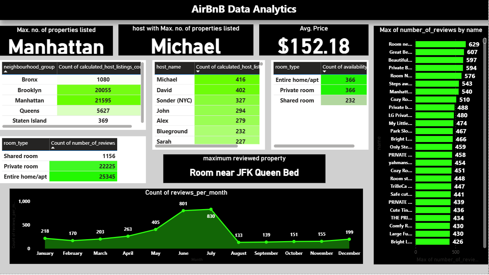
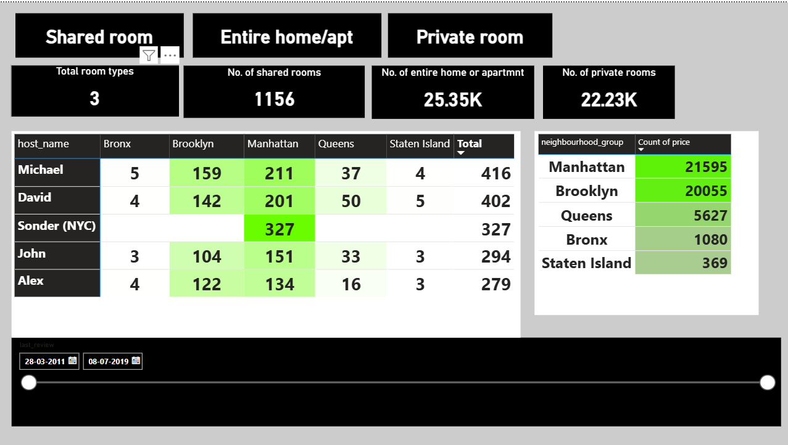

# AirBnB-data-analyzation
Airbnb, Inc. is San Francisco, California based company which act as a broker and provides an online marketplace for short-term homestays. Here I try to analyze the data and give insights to enhance their business.

## Overview
This repository contains a Power-BI analytics solution designed to provide insights into the data analyzation of AirBnB.

The Key Performance Indicators (KPIs) used in the analysis are enlisted in the document 'Analyzation(Requirements).docx'. 

## Project Structure

project   
├── README.md # Documentation  
├── datasets/ # raw and cleaned data sources  
├── visuals/ # exported screenshots of dashboards  
├── reports/ # Power BI project files (.pbip)  
└── Analyzation(Requirements).docx

## Technologies Used

* Power BI Desktop - Data Modeling and Visualization
* SQL or Python - Data preprocessing and ETL
* GitHub - Version Control and Collaboration

## Key Features

* Interactive Dashboards with drill-down filters
* Trend Analysis and Forecasting
* KPI tracking across multiple dimensions
* Exportable reports for stakeholders

## Setup Instructions

* Clone the repository
* Open the .pbip file in Power BI Desktop
* Update the data source connections in dataset settings
* Refresh the report to load data

## Dashboard Preview

  

## Contributing

Contributions are Welcome!

* Fork the Repository
* Create a Feature Branch
* Submit a Pull Request

